# PukiwikiNorenFE

**店はそのまま、暖簾だけを新しく。**
PukiWiki をそのまま正本（データの置き場所・書き込み先）として残し、画面だけを今風に作り直す Web UI です。
PukiWiki の PHP やデータには手を入れず、接続先の URL を指定するだけで動きます。移行は要らず、いつでも元の画面に戻れます。

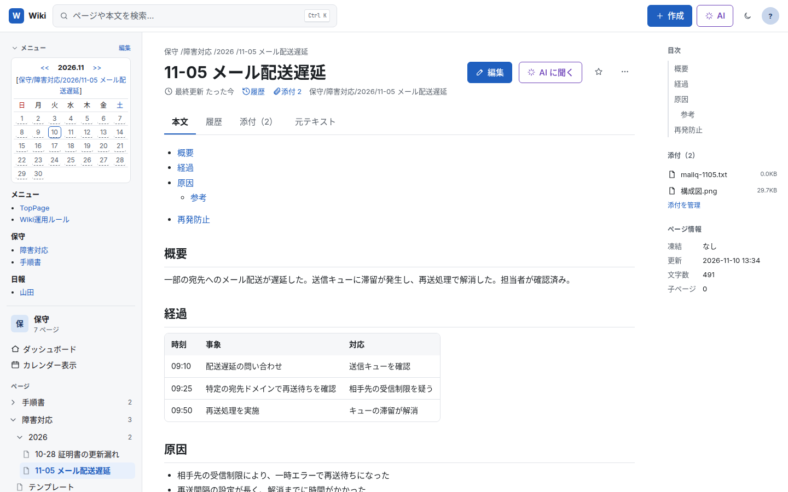

- 閲覧 / 編集（ビジュアル・ソース）/ 新規 / 名前変更 / 凍結 / 削除 / 履歴・差分・復元 / 添付 / 全文検索 / 一覧 /
  最近の更新 / 未作成ページ / 削除済み / 日報カレンダー / フォーム付きプラグイン（`#comment` など）の中継
- ビジュアルエディタは記法を 1 バイトも崩さずに往復（扱えない書き方は「生の記法」ブロックとして保持）
- `#calendar_viewer` と MenuBar の `#calendar2` を新しい画面の中で再現
- AI アシスタント（Claude API または OpenAI 互換 API）。ページの変更は「提案」だけで、人が承認したときに保存
- 1 つの画面から複数の PukiWiki につなげます

> **検証状況**：PukiWiki 1.5.4 の **EUC-JP 版**でのみ検証しています。UTF-8 版でも動くように作っていますが、確かめていません。

## 画面

画像は、試験用の PukiWiki（`dev/`）にサンプルページを入れて撮影したものです。

### ダッシュボード・検索

| ダッシュボード | 検索（Ctrl K） |
| --- | --- |
| 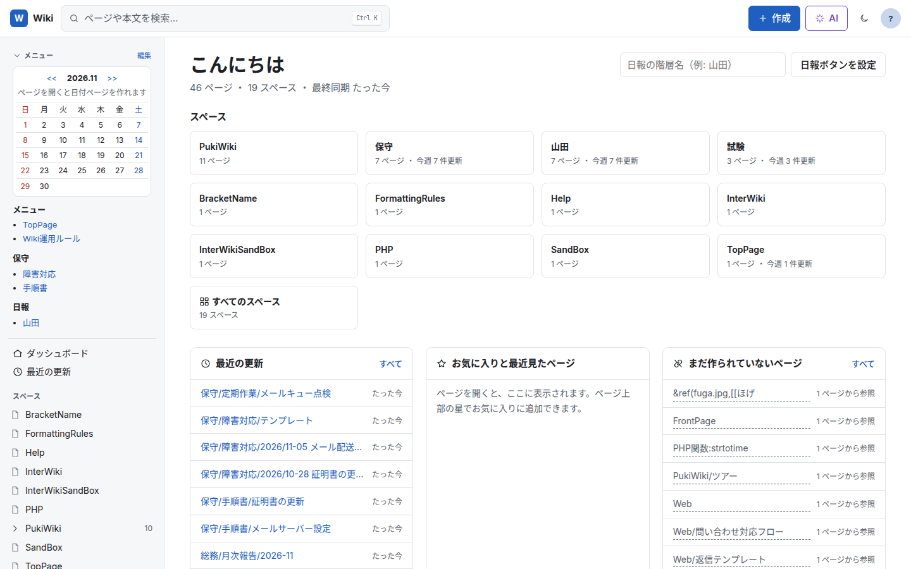 | 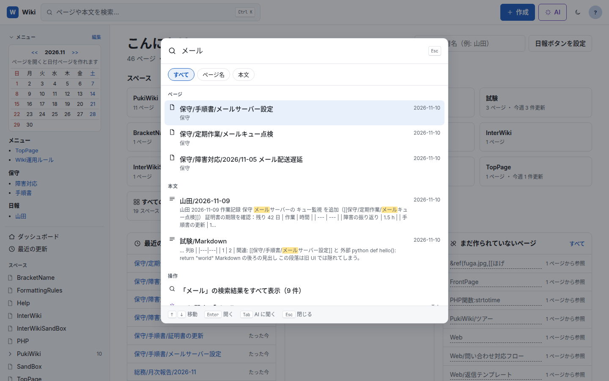 |

スペース（最上位の階層）ごとのページ数と、最近の更新を一覧します。`Ctrl K` で、ページ名と本文を同時に検索できます。

### 編集

| ビジュアル編集 | ソース編集 |
| --- | --- |
| 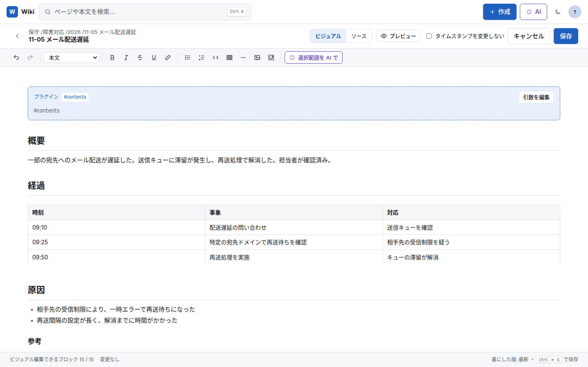 | 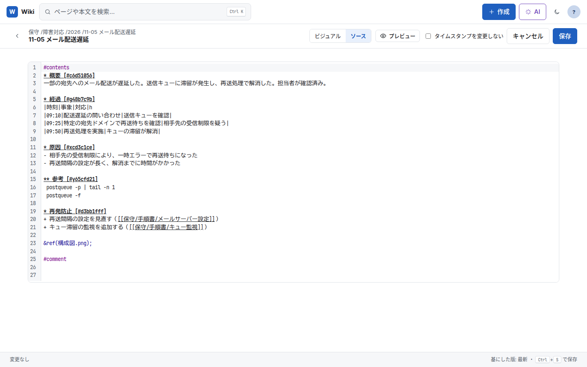 |

ビジュアルとソースは、いつでも切り替えられます。ビジュアルで扱えない書き方も消さずに残すので、保存しても記法は崩れません。

| 新しいページ | 履歴・差分 |
| --- | --- |
| 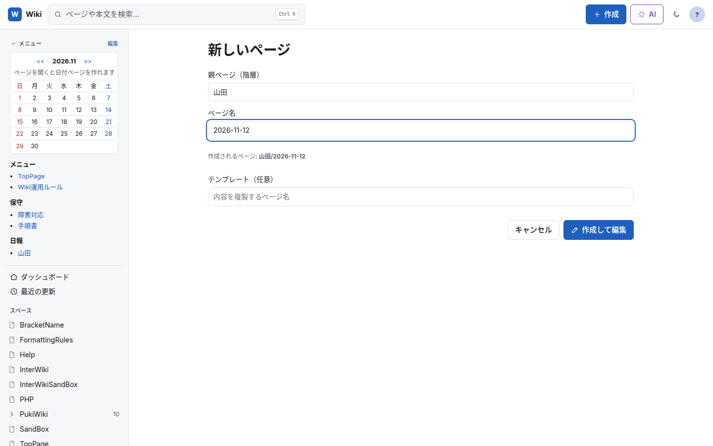 | 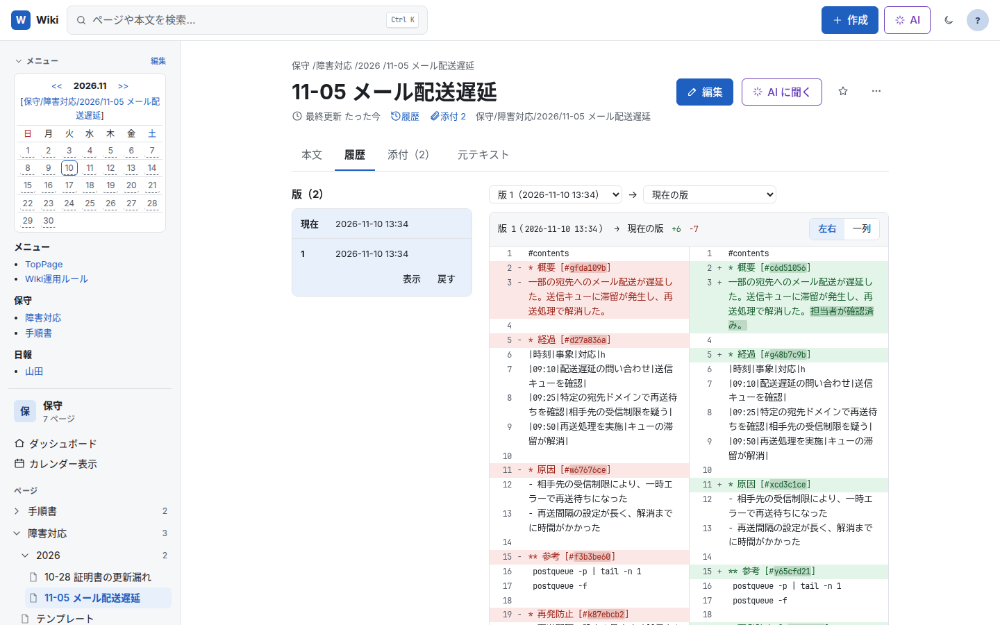 |

### 日報・カレンダー

| `#calendar_viewer` | 日報カレンダー |
| --- | --- |
| 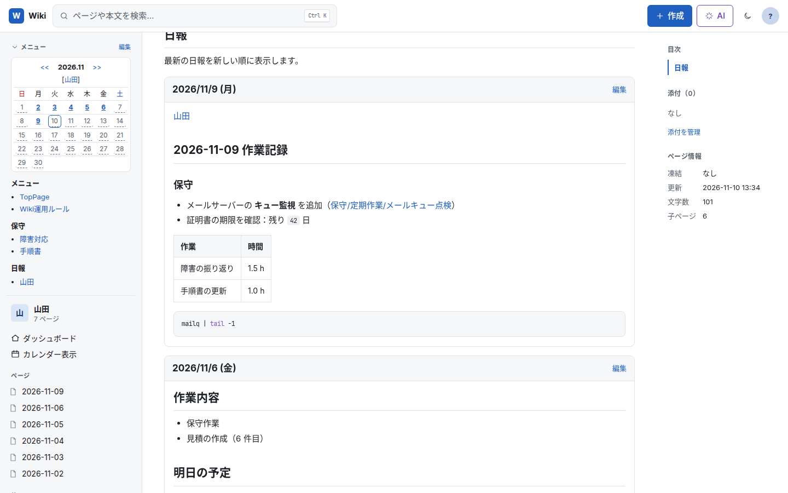 | 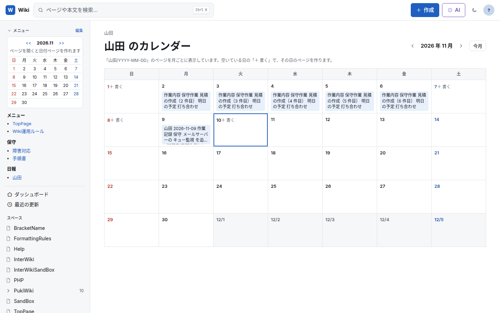 |

- `#calendar_viewer` は新しい画面の中で描画します。日付・「次の N 件」のリンクも新しい画面の中で動きます。
- サイドバー上部には `MenuBar` を表示します。MenuBar の `#calendar2` は**開いているページのカレンダー**になり、日付を押すとそのページの下に日付ページ（`ページ名/YYYY-MM-DD`）を作成・表示できます。

### Markdown（markdown プラグインを入れている場合）

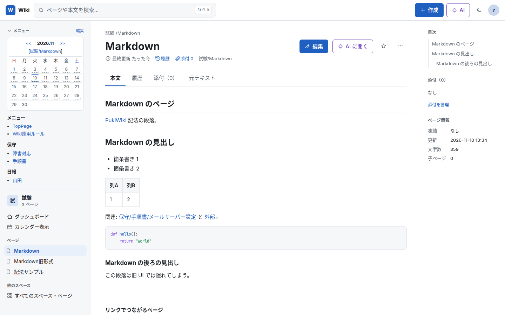

PukiWiki に [pukiwiki-plugin-markdown](https://github.com/epochnet/pukiwiki-plugin-markdown) を入れていると、`#markdown()` 〜 `#endmarkdown()`（または `#markdown{{ }}`）の部分を Markdown として表示し、エディタでも Markdown ブロックとして編集できます。

- プラグインが入っているかは、起動時に自動で判定します（`PUKIWIKI_MARKDOWN_PLUGIN=on|off` で上書き可）
- 入っていない Wiki では、その部分は PukiWiki の表示のまま扱い、エディタの「Markdown ブロック」も出しません

### AI アシスタント

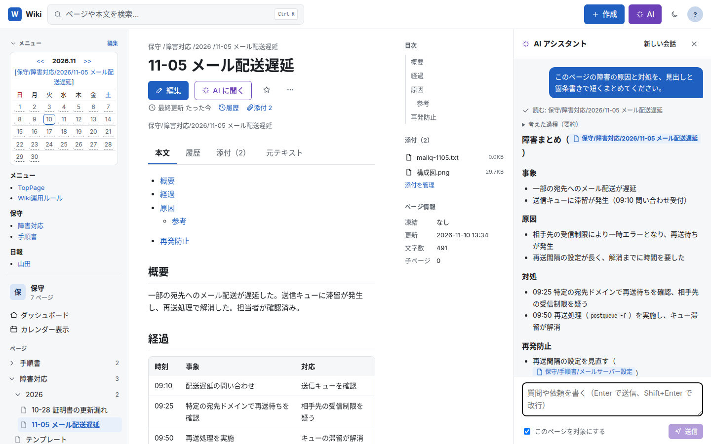

Wiki を検索・閲覧して答えます。根拠にしたページへのリンクが付き、返答は Markdown で表示します。
ページの変更は「提案」として作るだけで、人が差分を見て承認したときにだけ保存されます。
Claude API のほか、OpenAI 互換 API（llama.cpp・vLLM・Ollama など手元や組織内に置いた LLM）も使えます。

### 表示の調整

| 列の幅を変える | ダークテーマ |
| --- | --- |
| 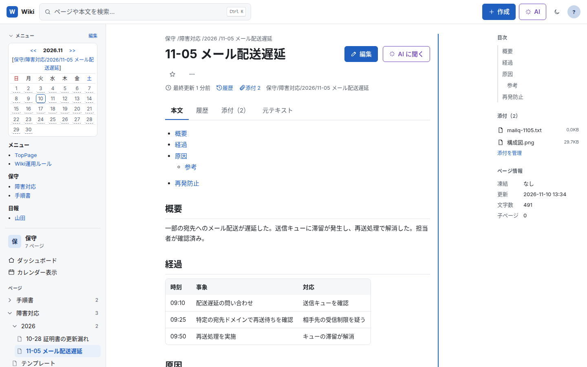 | 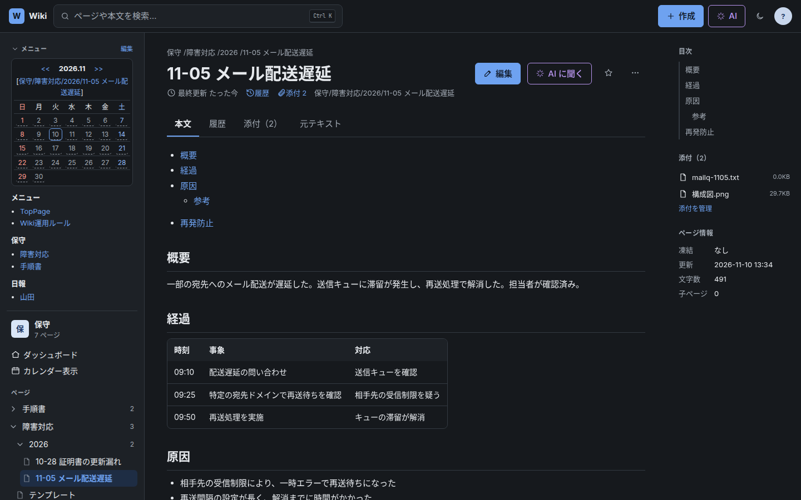 |

パソコンでは、サイドバー・本文・目次・AI パネルの幅を境目のドラッグで変えられます（ダブルクリックで元に戻す。キーボードでも操作可）。本文は中央に置き、左右どちらの端からでも両側が同じだけ広がります。

### スマートフォン

| ページ | メニュー |
| --- | --- |
| 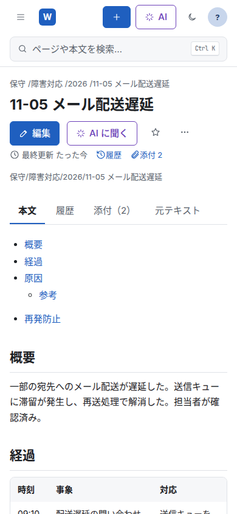 | 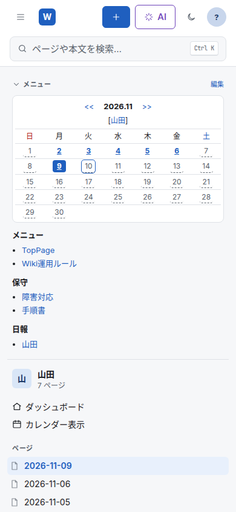 |

## 起動（Docker）

```bash
cp .env.example .env   # PUKIWIKI_URL などを設定
docker compose pull    # ghcr.io/epochnet/pukiwiki-noren-fe を取得
docker compose up -d   # http://127.0.0.1:8080
```

- イメージはリリースごとに `ghcr.io/epochnet/pukiwiki-noren-fe` に置いています（`:latest` と `:<バージョン>`）。手元のソースからビルドするときは `docker compose up -d --build` です。

- 初回起動時に全ページの索引を作ります（ページ数に応じて数分〜十数分）。以後は 60 秒ごとに最近の更新から差分を同期し、毎日 3 時に全件を同期します。
- `PUKIWIKI_ADMIN_PASSWORD` を設定すると、添付のアップロード（管理者限定の設定の Wiki）でパスワードを入力せずに済みます。凍結・名前変更・添付の削除は、その都度入力します。

### 安全のための初期設定

この画面を通すと、PukiWiki のページを編集できます。既定では**この PC からだけ**使える設定にしています。

- 待ち受けは `127.0.0.1` です（Docker では、ホストの `127.0.0.1:8080` だけに公開します）
- ほかの人と使う場合は、認証のあるリバースプロキシ（または `tailscale serve`）の内側に置き、利用者名をヘッダーで渡してください

| `AUTH_MODE` | 利用者の識別 |
| --- | --- |
| `none`（既定） | 識別しない。`127.0.0.1` で使うとき、または前段で認証しているときだけ |
| `header` | 認証プロキシが付けるヘッダー（`AUTH_HEADER`）から利用者名を取る |
| `tailscale` | `tailscale serve` が付ける `Tailscale-User-Login` ヘッダーから利用者名を取る |

`HOST` を `127.0.0.1` 以外にして `AUTH_MODE=none` のまま起動すると、警告をログに出します。

### 主な設定（`.env`）

| 変数 | 既定 | 説明 |
| --- | --- | --- |
| `PUKIWIKI_URL` | —（必須） | PukiWiki の URL（この画面のサーバーから接続する URL） |
| `PUKIWIKI_PUBLIC_URL` | `PUKIWIKI_URL` と同じ | 利用者のブラウザから開ける PukiWiki の URL。`PUKIWIKI_URL` を Docker のネットワーク内の名前（`http://pukiwiki/` など）にしたとき、「元の画面で開く」などのリンクに使う |
| `PUKIWIKI_LABEL` | `PukiWiki` | 画面に出す Wiki の名前 |
| `PUKIWIKI_ENCODING` | `auto` | `auto` / `euc-jp` / `utf-8` |
| `PUKIWIKI_ADMIN_PASSWORD` | 空 | 添付のアップロードに使う管理者パスワード |
| `PUKIWIKI_MARKDOWN_PLUGIN` | `auto` | markdown プラグインの有無（`auto` / `on` / `off`） |
| `WIKIS_CONFIG` | — | 複数の Wiki につなぐときの YAML（`config/wikis.example.yaml`） |
| `HOST` / `PORT` | `127.0.0.1` / `8080` | 待ち受け |
| `AUTH_MODE` / `AUTH_HEADER` | `none` | 上の表を参照 |
| `AI_PROVIDER` | `anthropic` | `anthropic`（Claude API）/ `openai`（OpenAI 互換 API） |
| `ANTHROPIC_API_KEY` | 空 | 設定すると AI が有効 |
| `OPENAI_BASE_URL` / `OPENAI_API_KEY` | — | `AI_PROVIDER=openai` のとき（URL は `…/v1` まで） |
| `AGENT_MODEL` | `claude-opus-5-5` | `AI_PROVIDER=openai` のときは必須 |
| `AGENT_EXCLUDE_PAGES` | 空 | AI に見せないページ（glob、カンマ区切り） |
| `MCP_URL` | — | [pukiwiki-mcp](https://github.com/epochnet/pukiwiki-mcp) の URL（任意、読み取りのみで使用） |

### AI を使う場合の注意

- 質問に関係するページの本文が、設定した AI の API（Claude API や OpenAI 互換 API の提供元）に送られます。外部に出したくない場合は、組織内に置いた LLM を `AI_PROVIDER=openai` で使ってください。
- パスワードや API キーの形をした文字列は、送る前に `[REDACTED]` に置き換えます（`AGENT_REDACT_PATTERNS` で追加可）。見せたくないページは `AGENT_EXCLUDE_PAGES` で除外できます。
- pukiwiki-mcp を併用する場合は `docker compose --profile mcp up -d` と `MCP_URL=http://pukiwiki-mcp:8000/mcp` を設定します。

## 構成

```
packages/syntax   PukiWiki 記法 ⇄ エディタ文書（往復保証）、索引用テキスト抽出
apps/bff          Hono + node:sqlite。PukiWiki HTTP ドライバ、索引・同期、AI、API
apps/web          React + Tiptap + CodeMirror
e2e               Playwright（機能テスト・全画面スクリーンショット）
dev/              試験用 PukiWiki（docker compose）とサンプルページの投入スクリプト
```

## 開発

Node.js 24 以上が必要です。

```bash
npm install
(cd dev/pukiwiki-test && docker compose up -d --build)   # 試験用 PukiWiki: http://127.0.0.1:18090（管理者パスワード testpass）
python3 -I dev/seed-test-wiki.py                         # サンプルページを投入
PUKIWIKI_URL=http://127.0.0.1:18090/ PORT=18181 npm run dev:bff
npm run dev:web                                          # http://localhost:5173
```

- 試験用 PukiWiki は、本家の PukiWiki 1.5.4（EUC-JP 版）をダウンロードして作ります（チェックサムで確認）。ポートは `PUKIWIKI_TEST_PORT` で変えられます。
- markdown プラグインを入れて試すときは、[pukiwiki-plugin-markdown](https://github.com/epochnet/pukiwiki-plugin-markdown) の `plugin/` の中身を `dev/pukiwiki-test/plugin/` にコピーしてから、`docker compose up -d --build` します。

## テスト

```bash
npm test                               # 記法の往復・結合テスト（試験用 PukiWiki が必要）
npm run build && npx playwright test   # E2E と全画面スクリーンショット（e2e/screenshots/）
```

- 試験用 PukiWiki の URL は `TEST_PUKIWIKI_URL` で変えられます（既定 `http://127.0.0.1:18090/`）。
- E2E の Markdown 関係のテストには、試験用 PukiWiki に markdown プラグインが必要です。
- `dev/corpus/*.txt` に実際のページのソースを置くと、記法の往復テストがそれらでも実行されます（Git の管理外）。

## 関連プロジェクト

- [pukiwiki-plugin-markdown](https://github.com/epochnet/pukiwiki-plugin-markdown)：PukiWiki で Markdown を書くためのプラグイン（GPL-2.0-or-later）
- [pukiwiki-mcp](https://github.com/epochnet/pukiwiki-mcp)：PukiWiki を MCP のツールとして公開するサーバー（MIT）

## ライセンス

MIT（[LICENSE](LICENSE)）。Copyright (c) 2026 株式会社EPOCH-NET
